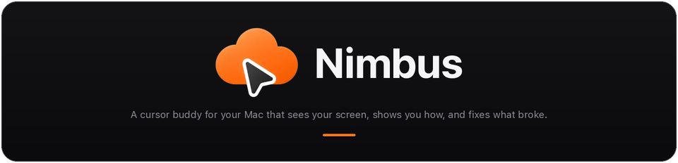
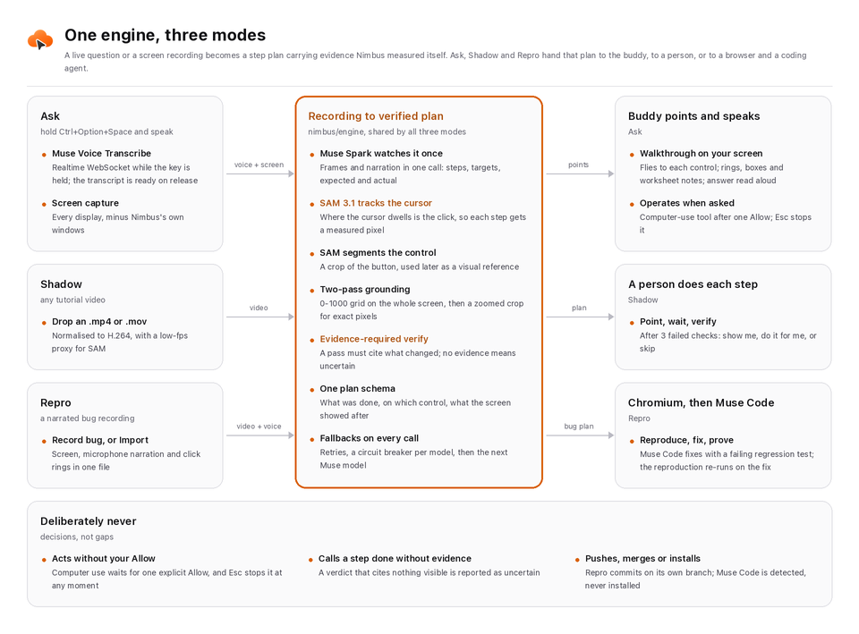
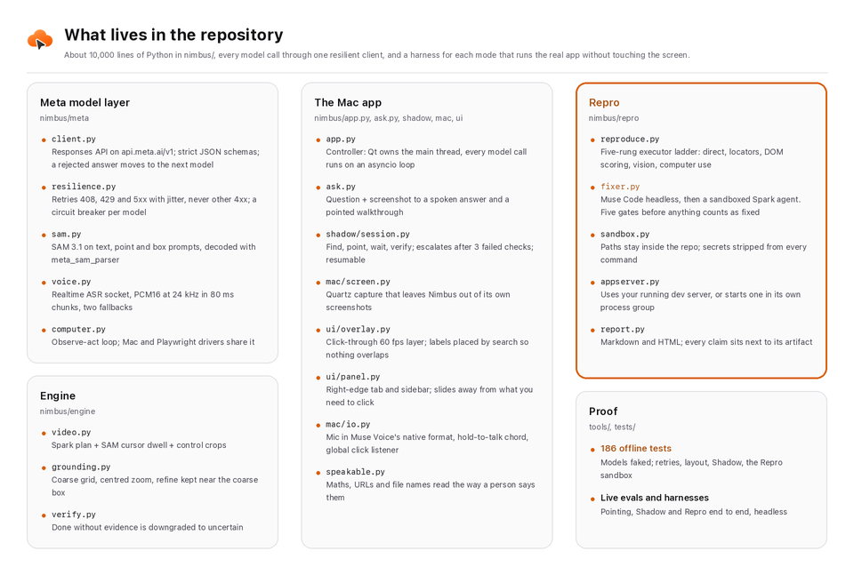
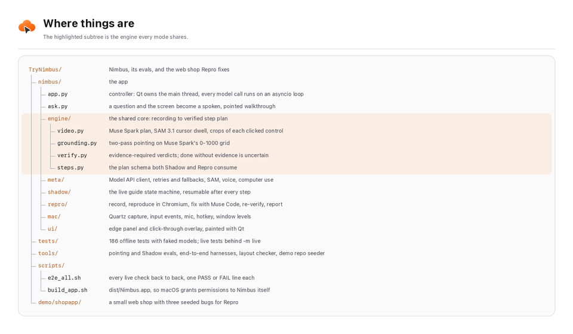

<div align="center">

<picture>
  <source media="(prefers-color-scheme: dark)" srcset="assets/readme/hero-dark.png">
  <source media="(prefers-color-scheme: light)" srcset="assets/readme/hero-light.png">
  
</picture>

<br>

[](https://cerebralvalley.ai/e/meta-ai-developer-hackathon)
[](#hackathon)
[](#hackathon)

[](#why-metas-models)
[](#why-metas-models)
[](#why-metas-models)
[](#why-metas-models)
[](#why-metas-models)
[](#why-metas-models)

[](#run-it-locally)
[](#run-it-locally)
[](LICENSE)
[](#tests-evals-and-harnesses)
[](#results)
[](#results)

**Hold a key, ask about anything on your screen, and a second cursor flies to the exact control while Nimbus explains it out loud.**
<br>
**Hand it a tutorial video and it guides you through it on your own screen, checking every step.**
<br>
**Hand it a narrated bug recording and it reproduces the bug, fixes it with Muse Code, and proves the fix.**

[Download](#download-the-app) · [Demo](#demo) · [What it does](#what-it-does) · [How it works](#how-it-works) · [Why Meta's models](#why-metas-models) · [Results](#results) · [Technical details](#technical-details) · [Run it locally](#run-it-locally)

</div>

## Demo

[](#demo)
[](https://github.com/EmadQureshiKhi/TryNimbus/releases/latest)

<!-- Demo video: replace #demo above with the YouTube link once the video is uploaded. -->

## For the judges

| Rubric | Where Nimbus stands |
|---|---|
| **Impact (30%)** | Everyone who uses a computer gets stuck on an interface, follows a tutorial made for a different version, or files a bug that cannot be reproduced. Nimbus solves all three on the person's own screen, with no description of the screen needed. See [The problem](#the-problem). |
| **Use of Meta AI tooling (25%)** | Five Meta models (six with the optional open-weights path) in closed loops where one model's output is checked by another: Muse Spark plans from video and narration in one call, SAM 3.1 *tracks the presenter's mouse cursor* to measure where every click happened, Spark's 0-1000 grounding grid points at controls, Muse Code fixes bugs headless, and Spark verifies every claim against screenshots. See [Why Meta's models](#why-metas-models). |
| **Technical depth (20%)** | One engine (screen recording → verified step plan) shared by three products. Resilient client with retries, circuit breakers and model fallback chains; two-pass grounding; evidence-required verification; a five-rung browser executor; a sandboxed coding agent with five proof gates. See [Technical details](#technical-details). |
| **Demo (25%)** | Every number below comes from live runs against the real Meta Model API. Shadow and Repro each have a harness that drives the real app end to end, headless. See [Results](#results). |

## The problem

You are inside a piece of software and you are stuck.
Not on the idea, on the *interface*.
Where is the blade tool?
Which button starts a new chat?
What do I click next in this 40-minute tutorial recorded on an older version than mine?

Three things fail people today:

1. **Chat assistants make you describe the screen.** Describing it is the hard part.
2. **Tutorial videos do not know your screen.** You pause, scrub, and squint at a button that moved in your version.
3. **Bug reports lose the screen.** "It broke when I added two items" turns into a day of "cannot reproduce".

Nimbus looks at the same screen you do, so you never describe it.
It *shows* instead of tells, and it checks its own work before it says anything is done.

## What it does

Nimbus lives on the right edge of your Mac as a slim tab.
A buddy cursor follows yours.
Three modes share one engine.

### Ask: point, teach, or do it for you

Hold **Ctrl+Option+Space**, ask out loud, release.

- *"How do I open a new chat?"* The buddy flies to the button, rings it, and says what to click.
- *"Walk me through cutting a clip and exporting it."* A numbered walkthrough, one control at a time, each line spoken as the buddy lands.
- *"Solve problem 2 step by step."* Working notes are pinned under the exact term of the equation they explain, like a worksheet.
- *"Open Notes and start a new note."* After one Allow, Nimbus operates the Mac with the computer-use tool and tells you when it is done. Esc stops it at any moment.

### Shadow: any tutorial video becomes a live guide on your screen

Drop in a screen-recorded tutorial.
Nimbus watches it once (pictures and narration together) and learns the steps, with a picture of every control that was clicked.
Then it guides you through the same task on your own screen, even when your theme, window size or app version looks different from the video.
Each step is pointed at, spoken, and **verified from screenshots** before it moves on.
If you get stuck, choose *Show me*, *Do it for me*, or *Skip*.

### Repro: a narrated bug recording becomes a verified fix

Record your screen while you say what went wrong, or import a recording.
Nimbus turns it into a step plan, reproduces the bug in a real Chromium, hands it to **Muse Code** to fix with a regression test, re-runs the reproduction on the fixed code, and writes a report with before and after evidence.
Nothing is pushed or merged: the fix waits on its own branch for a human.

## How it works



The core idea is a single representation: **a step plan carrying evidence Nimbus measured itself**.
Each step says what was done, on which control, what the control looked like, and what the screen showed afterwards.

- **Ask** builds the plan from your question and a screenshot, then the buddy performs it as a walkthrough.
- **Shadow** builds the plan from a tutorial video, then hands it to a person, one verified step at a time.
- **Repro** builds the plan from a bug video, then hands it to an automated executor and a coding agent.

## Why Meta's models

Nimbus runs only on Meta's models, and each one does something the product could not do without it.

| Model | What it does in Nimbus | Why this model |
|---|---|---|
| **Muse Spark 1.3 / 1.2** | Answers and plans walkthroughs from screenshots; watches tutorial and bug videos; points at controls; verifies every step | Reads video *and its audio track* in one call, so a narrated tutorial becomes a step plan with what was said at each step. Its 0-1000 grounding grid makes pointing resolution-independent across Retina displays. 1M context holds a long tutorial whole. |
| **SAM 3.1** | Tracks the presenter's mouse cursor through the tutorial; segments the control under each click | Clicks happen where the cursor dwells, so tracking the cursor gives the *measured* click point instead of a guess. Point-prompted segmentation crops the exact control, which Shadow later uses as a visual reference on a screen that looks different. |
| **Muse Voice Transcribe** | Push-to-talk questions; narration in bug recordings | Realtime WebSocket with cumulative partials, so the transcript is ready the moment you release the key. |
| **Muse Spark / Muse Wonder (computer tool)** | "Do it for me" in Shadow; "open Notes and start a note" in Ask; the last rung of Repro's executor | A native observe-act protocol whose safety checks Nimbus routes to the person. |
| **Muse Code** | Repro's fixer: confirms the root cause, writes a failing regression test, fixes, runs the tests | Driven headless (`muse exec`) inside its own sandbox, scoped to the repository, key passed on stdin. Nimbus then re-checks everything itself. |
| **Muse Spark Open** (optional) | Step verification on open weights through Baseten | Same client and harness, swappable endpoint, one switch in Settings. |

### Capabilities we put to work in new ways

- **SAM 3.1 as a click detector.** SAM is built to segment objects. Nimbus asks it to track the mouse cursor through a screen recording, finds where the cursor came to rest, and uses that as the measured moment and pixel of each click. A second SAM call then segments the control under that pixel.
- **Two models checking each other.** Muse Spark writes the plan, SAM measures where it happened, Spark grounding finds the same control on a different screen, and a separate Spark verifier must cite visible evidence before anything counts as done.
- **A coding agent that is not trusted.** Muse Code's summary is never taken at its word. A fix only counts when the tests pass, a test file changed, the new test *fails on the old code* (checked in a separate worktree), the diff is non-empty, and the diff contains no secrets. Then the original reproduction re-runs on the fixed app.
- **Narrated video in one call.** Spark 1.2 hears the narration while it watches, so "now open the model picker down here" becomes a step with its target and its spoken intent.

## Results

Every number below comes from live runs against the real Meta Model API, in headless Chromium, with ground truth read from the page's DOM.
The scripts are in [`tools/`](tools); each writes its raw results to `artifacts/evals/` when run.

| What was measured | Result |
|---|---|
| **Pointing on live public web apps** (GitHub, Wikipedia, Excalidraw, VS Code for the Web): "how do I download this code?", "which tool draws a rectangle?", "where is the extensions marketplace?" | **10 / 10** inside the exact element |
| **Pointing on fixture apps** (a chat app, and a video editor with icon-only tools) | **11 / 12** hits, median **8.5 px** from the element's centre |
| **Maths on screen**: every written working step anchored on the equation it explains | **2 / 2** problems |
| **Shadow, learning**: a narrated tutorial video turned into a step plan with SAM cursor evidence | **19.5 s** for the whole video |
| **Shadow, guiding**: the same app opened in a theme the video never showed | pointed right on **6 / 6** steps; **6 / 6** false passes blocked (nothing passes when the person did nothing); **5 / 6** completions verified with cited evidence, the sixth a focus-only click honestly marked "assumed" |
| **Shadow in the real app**, end to end: tab, panel, overlay, buddy, verification, *Show me* and *Do it for me* | **3 / 3** consecutive clean runs |
| **Repro in the real app**, end to end: narrated bug video → reproduction → Muse Code fix → re-verified → report | **19 / 19** checks; recording to verified fix in about **80 s**; the fix is the one-line root cause, and its new regression test fails on the old code |
| **Repro with the built-in Muse Spark fixer** (Muse Code not installed) | **3 / 3** consecutive runs, about 2 minutes each |
| **No overlaps**: every frame of real walkthroughs painted exactly as on screen, checked for overlapping text, covered targets and anything off screen | **9 / 9** walkthroughs clean across **40** frames |
| **Offline test suite** (models faked) | **186** passing |

Perceived latency: Nimbus starts speaking on the first answer while the zoomed second look sharpens the points in the background, so the buddy moves as it starts to talk.

## Technical details



### The Meta model layer

- **One client for every call.** The Responses API on `https://api.meta.ai/v1` through the plain OpenAI SDK, with strict JSON schemas for every structured answer.
- **Resilience.** Retries with exponential backoff and jitter on 408, 429, 5xx, timeouts and dropped connections, never on other 4xx, because a malformed request fails the same way every time. A circuit breaker per model. Each role (ask, grounding, video, verify, computer use, coder) is an ordered fallback chain, and the next model is tried only for model-specific failures.
- **Validated answers.** `respond_json(validate=...)` re-asks with the full original input when a reply does not parse, and moves to the next model when an answer parses but fails validation.
- **Voice.** Audio streams over the realtime WebSocket while the key is held. Every chunk is also kept locally, so if the socket fails the same audio goes to the one-shot endpoint, and then to Muse Spark's audio input.

### Pointing that lands on the pixel

1. **Coarse pass.** The whole screenshot (long side capped) goes to Muse Spark's 0-1000 grounding grid.
2. **Refine pass.** A full-resolution crop *centred* on the coarse hit (padded at screen edges, so the target never sits off-centre) is asked again. A 16 px icon becomes a 60 px icon.
3. **Sanity.** A refined point that wanders outside the coarse box is discarded in favour of the coarse hit.

Coordinates are global Quartz points everywhere; screenshots are Retina pixels; the grid is per image. One `Capture` object converts between them.

### Turning a recording into a plan

1. Muse Spark watches the recording, pictures and narration together, and writes the step plan: action, target, typed text, expected and actual (for bugs).
2. SAM 3.1 tracks the cursor through a low-fps proxy. For each step, the longest still run after a move gives the arrival and leave times, which pick the *before* and *after* frames.
3. SAM segments the control under the click pixel, skipping segments that are mostly the cursor itself, and the crop is grown to a readable minimum size.
4. A review pass gives each step a natural instruction, the guide a short title, and the starting state a plain sentence.

### Verification that refuses to guess

A verdict is `done`, `not_done` or `uncertain`, and a `done` must cite visible evidence from the after screenshot.
A `done` without evidence is downgraded to `uncertain`.
Shadow runs a negative check first (nothing happened, so nothing may pass), and after three failed checks it stops guessing and asks the person.

### Repro, step by step

- **Executor ladder**, cheapest and most deterministic first: direct actions, accessibility locators (a locator must match exactly one visible element, and ties are never guessed), DOM scoring, vision grounding with the recorded crop, then computer use. A failed step retries once from the top.
- **Fixer.** Muse Code runs headless with its sandbox on. Without Muse Code, a built-in Muse Spark coding agent works through a sandbox whose paths resolve inside the repository, whose commands are limited to the configured test command, and whose environment has every secret stripped.
- **Proof gates.** Tests pass, the diff is non-empty, a test file changed, the new tests fail on the original code, and no secrets are in the diff. Only then is the fix committed on `nimbus/repro-<plan id>`.
- **Report.** Markdown (for a draft PR) and standalone HTML, with every claim next to its artifact: the bug frame, the reproduction video, the verifier's cited evidence before and after, the diff and the test output.

### The Mac app

- **Nimbus never sees itself.** Capture asks the window server for every on-screen window except Nimbus's own, so the overlay stays out of the model's screenshots but visible to screen recorders.
- **Nothing overlaps.** Labels, note cards and captions are placed by search: each tries spots around its target and takes the first that is on screen and clear of everything else, including the side panel. The panel slides to the other edge when it covers the control you need to click.
- **Responsive by construction.** Qt owns the main thread; every model call, socket and subprocess runs on an asyncio loop on a worker thread, and hops back with `ui()` / `ui_call()`.
- **Natural speech.** Meta has no text-to-speech, so answers are spoken with the best installed macOS voice, after `speakable()` turns maths, URLs, file names and acronyms into the words a person would say. Captions keep the original text.
- **Acting is gated.** Computer use needs Accessibility permission and one explicit Allow; screen-steering safety checks from the API go to the person; Esc stops everything.

### Where things are



### Tests, evals and harnesses

| Command | What it proves | Needs the key |
|---|---|---|
| `.venv/bin/python -m pytest` | 186 offline tests with faked models: retries, coordinate mapping, layout stress cases, the Shadow state machine, the Repro sandbox, executor and fixer rules | no |
| `.venv/bin/python tools/eval_pointing.py [--web]` | Pointing hit rate against DOM ground truth, on fixture apps or live public sites | yes |
| `.venv/bin/python tools/eval_shadow.py` | Learn a tutorial video, then guide a simulated person through it in a different theme | yes |
| `.venv/bin/python tools/shadow_e2e.py` | The real Nimbus app, offscreen, guiding a person through a tutorial in headless Chromium | yes |
| `.venv/bin/python tools/repro_e2e.py` | The real Nimbus app, offscreen, taking a bug video to a verified fix in a throwaway copy | yes |
| `.venv/bin/python tools/check_layout.py` | Paints every frame of real walkthroughs and fails on any overlap | yes |
| `scripts/e2e_all.sh` | Everything above, back to back, one PASS or FAIL line each | yes |

All of them run headless: no windows, no sound, no mouse or keyboard, safe while the Mac is in use.

## Run it locally

### Download the app

The quickest way to try Nimbus is the ready-made app for Apple silicon Macs (macOS 13 or later), with Python and every dependency inside.

1. Download `Nimbus-0.1.0-arm64.dmg` from the [latest release](https://github.com/EmadQureshiKhi/TryNimbus/releases/latest), open it and drag **Nimbus** to **Applications**.
2. The app is not notarized, so open it the first time with right-click > **Open** > **Open**. On macOS 15 and later, open it once, then click **Open Anyway** in System Settings > Privacy & Security.
3. Nimbus opens on its Settings page: paste your Meta Model API key there (it is kept in the macOS Keychain).
4. Allow **Screen Recording**, **Accessibility**, **Microphone** and **Input Monitoring** when asked, then quit and reopen Nimbus once so Screen Recording takes effect.

Repro also needs Google Chrome (or Playwright's Chromium) and, for the project it fixes, git and Node.js.
To build the same disk image yourself, run `scripts/build_release.sh`.

### Requirements

| Needs | Version |
|---|---|
| **Mac** | macOS 13 or later (developed on Apple silicon) |
| **Python** | 3.11 or later (3.12 recommended) |
| **Node.js** | 18 or later, for the Repro demo shop's tests |
| **Optional** | Muse Code CLI (Repro's primary fixer); `ffmpeg` (faster video handling, with macOS's own AVFoundation as the fallback, and needed only to regenerate the sample videos) |

### Keys

| Variable | Required | What it is for |
|---|---|---|
| `MODEL_API_KEY` | **yes** | Meta Model API key from [dev.meta.ai](https://dev.meta.ai), format `LLM\|<id>\|<secret>`. Every model call uses it. |
| `BASETEN_API_KEY` | no | Only for the optional *Open-weights checks* switch (Muse Spark Open on Baseten). |
| `GH_TOKEN` | no | Only if you set `repro.open_pull_request` in `~/.nimbus/settings.json` and the `gh` CLI is not already signed in. |

Put them in `.env` at the repository root (see [`.env.example`](.env.example)), or paste the Meta key into Nimbus's Settings tab, which stores it in the macOS Keychain.

### Install and launch

```bash
python3.12 -m venv .venv
```

```bash
.venv/bin/pip install -e ".[dev]"
```

```bash
.venv/bin/python -m playwright install chromium
```

```bash
cp .env.example .env
```

Open `.env` and set `MODEL_API_KEY`. Then build the small app bundle and launch it:

```bash
./scripts/build_app.sh && open dist/Nimbus.app
```

The bundle runs this checkout's `.venv`, so macOS grants permissions to *Nimbus* rather than to your terminal.
When asked, allow **Screen Recording**, **Accessibility** and **Microphone** (the Settings tab shows each one's status).
You can also run it straight from a terminal with `.venv/bin/python -m nimbus`, in which case the permissions go to the terminal app.

Muse Code is optional.
Nimbus looks for it on `PATH`, in `~/.local/bin`, or at `$MUSE_BIN`, and never installs it.
To install it with Meta's installer:

```bash
curl -fsSL https://dev.meta.ai/install.sh | bash
```

### Try each mode

**Ask.** Hold **Ctrl+Option+Space**, say *"how do I open a new chat?"* with any chat app on screen, and release.
You can also type the question in the Ask tab.

**Shadow.** A sample narrated tutorial ships in the repository: [`artifacts/fixtures/tutorial_chat.mp4`](artifacts/fixtures/tutorial_chat.mp4), a walkthrough of the fixture chat app.
Open the app, drop the video on the Shadow tab, and follow the buddy:

```bash
open tests/fixtures/ui/chat_app.html
```

Any screen-recorded tutorial of your own works the same way.

**Repro.** Make a git working copy of the demo shop, which has three seeded bugs, then serve it:

```bash
.venv/bin/python tools/demo_repo.py shopapp
```

```bash
cd runs/demo/shopapp && python3 -m http.server 5173 --bind 127.0.0.1
```

Then either click *Record bug* in the Repro tab and narrate a bug (add two of the same item and watch the total), or import the sample narrated bug recording, [`artifacts/fixtures/bug_cart_total.mp4`](artifacts/fixtures/bug_cart_total.mp4).

Repro leaves the fix on a `nimbus/repro-<id>` branch of `runs/demo/shopapp`, which is where the Repro settings point by default.
Run `tools/demo_repo.py shopapp --reset` before the next try.

### No permissions? Watch it work headless

Every mode can be exercised without granting anything and without touching your screen:

```bash
.venv/bin/python tools/repro_e2e.py
```

```bash
.venv/bin/python tools/shadow_e2e.py
```

Each drives the real Nimbus app offscreen against headless Chromium, prints a PASS or FAIL line per check, and records a video of the run under `artifacts/evals/`.

## Hackathon

- **Event:** [Meta Global AI Developer Hackathon](https://cerebralvalley.ai/e/meta-ai-developer-hackathon), October 26 to November 4, 2026
- **Track:** Indie Developer
- **Problem statement:** Build for Your World
- **Author:** Emad Qureshi
- **License:** [MIT](LICENSE)

<div align="center">
<br>
<sub><b>Built during the hackathon period (October 26 to November 4, 2026) by Emad Qureshi.</b></sub>
</div>
