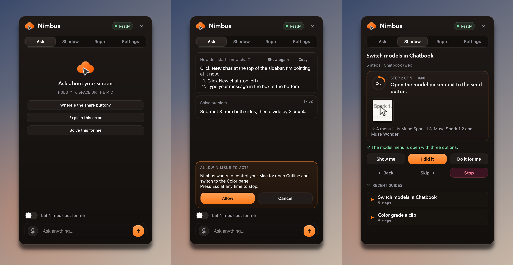
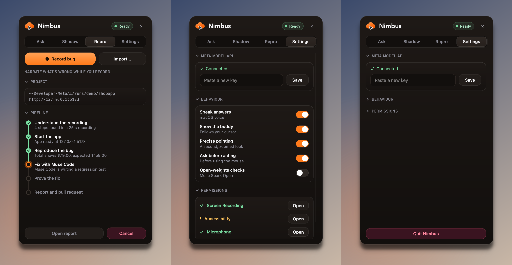

<div align="center">

<picture>
  <source media="(prefers-color-scheme: dark)" srcset="assets/readme/hero-dark.png">
  <source media="(prefers-color-scheme: light)" srcset="assets/readme/hero-light.png">
  
</picture>

<br>

[](https://cerebralvalley.ai/e/meta-ai-developer-hackathon)
[](#hackathon)
[](#hackathon)

[](#meta-models-and-what-each-one-does)
[](#meta-models-and-what-each-one-does)
[](#meta-models-and-what-each-one-does)
[](#meta-models-and-what-each-one-does)
[](#meta-models-and-what-each-one-does)
[](#meta-models-and-what-each-one-does)

[](#test-it-locally)
[](#results)
[](#results)
[](#download-the-app)
[](LICENSE)

**Hold a key, ask about anything on your screen, and a second cursor flies to the exact control while Nimbus explains it out loud.**
<br>
**Hand it a tutorial video and it guides you through it on your own screen, checking every step.**
<br>
**Hand it a narrated bug recording and it reproduces the bug, fixes it with Muse Code, and proves the fix.**

[Demo](#demo) · [At a glance](#at-a-glance) · [For the judges](#for-the-judges) · [What it does](#what-it-does) · [How it works](#how-it-works) · [Meta models](#meta-models-and-what-each-one-does) · [Results](#results) · [Test it locally](#test-it-locally) · [Download](#download-the-app)

</div>

## Demo

<div align="center">

<a href="https://youtu.be/tUhhuy_-KD0"></a>

[](https://youtu.be/tUhhuy_-KD0)
[](https://github.com/EmadQureshiKhi/TryNimbus/releases/latest)

</div>

Everything in the video is the real app on Meta's models, recorded live:

- **Ask** explains a footnote in the Transformer paper, operates Meta's own Ad Library end to end, and works out a bioinformatics alignment table cell by cell.
- **Shadow** learns a narrated VS Code tutorial and guides the viewer through it on their own screen, rejecting a wrong click.
- **Repro** takes a teammate's bug recording, reproduces it in Chromium, has Muse Code fix it, re-verifies it, and writes the report.

## At a glance

| | Nimbus |
|---|---|
| **What it is** | A native macOS assistant that lives beside your cursor, sees your screen, and *shows* you what to do instead of telling you. |
| **Who it helps** | Anyone stuck in an unfamiliar interface, anyone following a tutorial made for a different version, and every team that receives bug reports nobody can reproduce. |
| **Three modes, one engine** | **Ask** (point, teach, or do it for you), **Shadow** (any tutorial video becomes a live guide), **Repro** (a bug recording becomes a verified fix). All three run on one representation: a step plan with evidence Nimbus measured itself. |
| **Meta models** | Muse Spark 1.3 and 1.2, SAM 3.1, Muse Voice Transcribe, Muse Code, Muse Wonder (agent fallback), and optionally Muse Spark Open on Baseten. No other model provider. |
| **Proof** | 186 offline tests, live evals against the real Meta Model API with DOM ground truth, and headless harnesses that drive the real app end to end. Raw results are committed in [`artifacts/evals/`](artifacts/evals). |
| **Try it** | [Download the Mac app](#download-the-app) or [run it from source](#test-it-locally). The offline test suite needs no API key. |
| **Track and problem** | Indie Developer · Build for Your World |
| **License** | [MIT](LICENSE) |

## For the judges

| Rubric | Where Nimbus stands | Evidence |
|---|---|---|
| **Impact (30%)** | Getting stuck on an interface, following an outdated tutorial, and filing a bug nobody can reproduce are daily problems for anyone who uses a computer. Nimbus solves all three on the person's own screen, with no need to describe the screen. | [The problem](#the-problem), [What it does](#what-it-does) |
| **Use of Meta AI tooling (25%)** | Five Meta models (six with open weights) in closed loops where one model checks another. Muse Spark plans from video and narration in one call. SAM 3.1 *tracks the presenter's mouse cursor* to measure where each click happened. Spark's 0-1000 grounding grid points at controls on a different screen. Muse Code fixes bugs headless. A separate Spark verifier must cite visible evidence before anything counts as done. | [Meta models](#meta-models-and-what-each-one-does), [`nimbus/meta/`](nimbus/meta), [`nimbus/engine/`](nimbus/engine) |
| **Technical depth (20%)** | One engine (screen recording to verified step plan) shared by three products. A resilient client with retries, circuit breakers and model fallback chains. Two-pass grounding. Evidence-required verification. A five-rung browser executor. A sandboxed coding agent behind five proof gates. A native Mac overlay that never covers what it explains. | [Technical details](#technical-details), [`tests/`](tests) |
| **Demo (25%)** | A real recording of the real app, plus numbers from live runs: 10 / 10 pointing hits on live websites, 19 / 19 Repro checks end to end, 5 / 5 Tally fixes by Muse Code. | [Demo](#demo), [Results](#results) |

**Indie track criteria.**
*Creativity:* SAM 3.1 used as a click detector, and tutorials that turn into guides on your own screen.
*Technical ambition:* three products on one verified engine, native macOS capture and overlay, and an autonomous fix loop that must prove itself.
*Whether it works:* a downloadable app, a recorded demo, and harnesses anyone can rerun.

**Bonus prize fit.**
*Best Agentic Use-Case:* Repro runs a multi-step agent from recording to verified fix with no human in the loop until review, and *Do it for me* finishes any procedure through the computer-use tool.
*Best Build on Meta Open Weight Models:* step verification and bug analysis can run on Muse Spark Open through Baseten with one switch.

## The problem

You are inside a piece of software and you are stuck.
Not on the idea, on the *interface*.
Where is the blade tool?
Which button starts a new chat?
What do I click next in this 40-minute tutorial recorded on an older version than mine?

Three things fail people today:

| Today | Why it fails | Nimbus |
|---|---|---|
| **Chat assistants** | They make you describe the screen, and describing it is the hard part. | Looks at the same screen you do and points at the exact control. |
| **Tutorial videos** | They do not know your screen. You pause, scrub, and hunt for a button that moved. | Learns the video once, then guides you on your own screen and checks each step. |
| **Bug reports** | "It broke when I added two items" turns into a day of "cannot reproduce". | Reproduces the recording in a real browser, fixes it, and proves the fix. |

Nimbus *shows* instead of tells, and it checks its own work before it says anything is done.

## What it does

Nimbus lives on the right edge of your Mac as a slim tab, and a buddy cursor follows yours.

### Ask: point, teach, or do it for you

Hold **Ctrl+Option+Space**, ask out loud, release.

| You say | Nimbus does |
|---|---|
| *"How do I open a new chat?"* | The buddy flies to the button, rings it, and says what to click. |
| *"Walk me through cutting a clip and exporting it."* | A numbered walkthrough, one control at a time, each line spoken as the buddy lands. |
| *"Fill in the missing cells and explain them."* | Working notes pinned under the exact term they explain, like a worksheet. Questions that need working get more reasoning effort. |
| *"Find all of Nike's ads running in the UK."* | With *Let Nimbus act for me* on and one Allow, Nimbus operates the Mac with the computer-use tool, then says the answer. Esc stops it at any moment. |

### Shadow: any tutorial video becomes a live guide

Drop in a screen-recorded tutorial.
Nimbus watches it once (pictures and narration together) and learns the steps, with a picture of every control that was clicked.
Then it guides you through the same task on your own screen, even when your theme, window size or app version differs from the video.
Each step is pointed at, spoken, and **verified from screenshots** before it moves on.
If you get stuck, choose *Show me*, *Do it for me*, or *Skip*.

### Repro: a narrated bug recording becomes a verified fix

Record your screen while you say what went wrong, or import a recording.
Nimbus turns it into a step plan, reproduces the bug in a real Chromium, hands it to **Muse Code** to fix with a regression test, re-runs the reproduction on the fixed code, and writes a report with before and after evidence.
Nothing is pushed or merged: the fix waits on its own branch for a human, and with GitHub connected it can open a draft pull request.





## How it works


The core idea is a single representation: **a step plan carrying evidence Nimbus measured itself**.
Each step says what was done, on which control, what the control looked like, and what the screen showed afterwards.

| Mode | Builds the plan from | Hands the plan to |
|---|---|---|
| **Ask** | Your question and a screenshot | The buddy, as a spoken walkthrough, or the computer-use agent |
| **Shadow** | A tutorial video | You, one verified step at a time |
| **Repro** | A bug video | An automated browser executor, then a coding agent |

## Meta models and what each one does

Nimbus runs only on Meta's models, through the Meta Model API (`https://api.meta.ai/v1`) and Muse Code.
Each one does something the product could not do without it.

| Model | What it does in Nimbus | Why this model |
|---|---|---|
| **Muse Spark 1.3**<br>`muse-spark-1.3`<br>[`ask.py`](nimbus/ask.py), [`grounding.py`](nimbus/engine/grounding.py), [`verify.py`](nimbus/engine/verify.py) | Answers and plans walkthroughs from screenshots, points at controls, verifies every step, drives computer use | Its 0-1000 grounding grid makes pointing resolution-independent across Retina displays. Strict JSON schemas keep every answer machine-checkable. |
| **Muse Spark 1.2**<br>`muse-spark-1.2`<br>[`video.py`](nimbus/engine/video.py) | Watches narrated tutorial and bug videos and writes the step plan | Reads video *and its audio track* in one call, so what was said at each step lands in the plan. 1M context holds a long tutorial whole. |
| **SAM 3.1**<br>`sam-3.1`<br>[`sam.py`](nimbus/meta/sam.py), [`video.py`](nimbus/engine/video.py) | Tracks the presenter's mouse cursor through a recording, then segments the control under each click | Clicks happen where the cursor comes to rest, so tracking it gives the *measured* click point. The segmented crop is the visual reference Shadow uses on a screen that looks different. |
| **Muse Voice Transcribe**<br>`muse-voice-transcribe-1.0`<br>[`voice.py`](nimbus/meta/voice.py) | Push-to-talk questions | Realtime WebSocket, so the transcript is ready the moment you release the key. |
| **Muse Code**<br>`muse exec`<br>[`fixer.py`](nimbus/repro/fixer.py) | Repro's fixer: confirms the root cause, writes a failing regression test, fixes, runs the tests | Runs headless inside its own sandbox, scoped to the repository, with the key passed on stdin. Nimbus then re-checks everything itself. |
| **Muse Wonder**<br>`muse-wonder-1.0`<br>[`config.py`](nimbus/config.py), [`computer.py`](nimbus/meta/computer.py) | Second model in the computer-use and coding-agent fallback chains | Built for long-running agents and error recovery, so a task survives a failing first model. |
| **Muse Spark Open** (optional)<br>via Baseten<br>[`config.py`](nimbus/config.py) | Step verification and bug analysis on open weights | Same client and harness, swappable endpoint, one switch in Settings. |

### Capabilities put to work in new ways

- **SAM 3.1 as a click detector.** SAM is built to segment objects. Nimbus asks it to track the mouse cursor through a screen recording, finds where the cursor came to rest, and uses that as the measured moment and pixel of each click. A second SAM call then segments the control under that pixel.
- **Models checking each other.** Muse Spark writes the plan, SAM measures where it happened, Spark grounding finds the same control on a different screen, and a separate Spark verifier must cite visible evidence before anything counts as done.
- **A coding agent that is not trusted.** Muse Code's summary is never taken at its word. A fix only counts when the tests pass, a test file changed, the new test *fails on the old code*, the diff is non-empty, and the diff contains no secrets. Then the original reproduction re-runs on the fixed app.
- **Narrated video in one call.** Spark 1.2 hears the narration while it watches, so "now open the model picker down here" becomes a step with its target and its spoken intent.

## Results

Every number comes from live runs against the real Meta Model API, in headless Chromium, with ground truth read from the page's DOM.

| What was measured | Result | Evidence |
|---|---|---|
| **Pointing on live public web apps**: GitHub, Wikipedia, Excalidraw, VS Code for the Web | **10 / 10** inside the exact element | [`pointing_web.md`](artifacts/evals/pointing_web.md) |
| **Pointing on fixture apps**: a chat app, and a video editor with icon-only tools | **11 / 12** hits, median **8.5 px** from the element's centre | [`pointing.md`](artifacts/evals/pointing.md) |
| **Maths on screen**: every working step anchored on the equation it explains | **2 / 2** problems | [`pointing.md`](artifacts/evals/pointing.md) |
| **Shadow, learning**: a narrated tutorial turned into a step plan with SAM cursor evidence | **19.5 s** for the whole video | [`shadow.json`](artifacts/evals/shadow.json) |
| **Shadow, guiding**: the same app in a theme the video never showed | **6 / 6** steps pointed right, **6 / 6** false passes blocked, **5 / 6** completions verified with cited evidence (the sixth, a focus-only click, honestly marked "assumed") | [`shadow.json`](artifacts/evals/shadow.json) |
| **Shadow in the real app**, end to end: tab, panel, overlay, verification, *Show me*, *Do it for me* | **3 / 3** consecutive clean runs | [`tools/shadow_e2e.py`](tools/shadow_e2e.py) |
| **Repro in the real app**, end to end: bug video, reproduction, Muse Code fix, re-verified, report | **19 / 19** checks, recording to verified fix in about **80 s**, and the new regression test fails on the old code | [`repro_e2e.json`](artifacts/evals/repro_e2e.json) |
| **Repro on a second app** (Tally, a one-cent rounding bug in a $100 three-way split) | **5 / 5** runs fixed by Muse Code, **13 / 13** checks each, 81 to 117 s per run | [`tally/`](artifacts/evals/tally) |
| **Repro with the built-in Muse Spark fixer** (Muse Code not installed) | **3 / 3** consecutive runs, about 2 minutes each | [`tests/test_repro_live.py`](tests/test_repro_live.py) |
| **No overlaps**: every frame of real walkthroughs checked for overlapping text, covered targets and anything off screen | **9 / 9** walkthroughs clean across **40** frames | [`layout.json`](artifacts/evals/layout/layout.json) |
| **Offline test suite** (models faked) | **186** passing | [`tests/`](tests) |

The screenshots behind each pointing result are next to the reports in [`artifacts/evals/`](artifacts/evals) (`pointing_*.png`, `web_*.png`, `layout/`).
Nimbus starts speaking on the first answer while a zoomed second look sharpens the points in the background, so the buddy moves as it starts to talk.

## Technical details


### The Meta model layer

- **One client for every call.** The Responses API through the plain OpenAI SDK, with strict JSON schemas for every structured answer.
- **Resilience.** Retries with exponential backoff and jitter on 408, 429, 5xx, timeouts and dropped connections, never on other 4xx, because a malformed request fails the same way every time. A circuit breaker per model. Each role (ask, grounding, video, verify, computer use, coder) is an ordered fallback chain, and the next model is tried only for model-specific failures.
- **Validated answers.** `respond_json(validate=...)` re-asks with the full original input when a reply does not parse, and moves to the next model when an answer parses but fails validation.
- **Voice.** Audio streams over the realtime WebSocket while the key is held. Every chunk is also kept locally, so if the socket fails the same audio goes to the one-shot endpoint.

### Pointing that lands on the pixel

1. **Coarse pass.** The whole screenshot goes to Muse Spark's 0-1000 grounding grid.
2. **Refine pass.** A full-resolution crop *centred* on the coarse hit is asked again, so a 16 px icon becomes a 60 px icon.
3. **Sanity.** A refined point that wanders outside the coarse box is discarded in favour of the coarse hit.

Coordinates are global Quartz points everywhere, screenshots are Retina pixels, and the grid is per image; one `Capture` object converts between them.

### Turning a recording into a plan

1. Muse Spark watches the recording, pictures and narration together, and writes the step plan: action, target, typed text, and for bugs the expected and actual result.
2. SAM 3.1 tracks the cursor through a low-fps proxy. For each step, the longest still run after a move gives the arrival and leave times, which pick the *before* and *after* frames.
3. SAM segments the control under the click pixel, skipping segments that are mostly the cursor itself.
4. A review pass gives each step a natural instruction, the guide a short title, and the starting state a plain sentence.

### Verification that refuses to guess

A verdict is `done`, `not_done` or `uncertain`, and a `done` must cite visible evidence from the after screenshot.
A `done` without evidence is downgraded to `uncertain`.
Shadow runs a negative check first (nothing happened, so nothing may pass), and after three failed checks it stops guessing and asks the person.

### Repro, step by step

| Stage | What happens |
|---|---|
| **Executor ladder** | Cheapest and most deterministic first: direct actions, accessibility locators (one exact visible match, ties never guessed), DOM scoring, vision grounding with the recorded crop, then computer use. |
| **Fixer** | Muse Code runs headless with its sandbox on. Without Muse Code, a built-in Muse Spark coding agent works through a sandbox whose paths stay inside the repository and whose environment has every secret stripped. |
| **Proof gates** | Tests pass, the diff is non-empty, a test file changed, the new tests fail on the original code, and no secrets are in the diff. Only then is the fix committed on `nimbus/repro-<plan id>`. |
| **Report** | Markdown and standalone HTML, with every claim next to its artifact: the bug frame, both recorded reproductions, the verifier's evidence, the diff and the test output. |

### The Mac app

- **Nimbus never sees itself.** Capture excludes Nimbus's own windows, so the overlay stays out of the model's screenshots but visible to screen recorders.
- **Nothing overlaps.** Labels, note cards and captions are placed by search, clear of each other, of the text they explain, and of the side panel, which slides to the other edge when it covers the control you need.
- **Responsive by construction.** Qt owns the main thread; every model call, socket and subprocess runs on an asyncio loop on a worker thread.
- **Natural speech.** Meta has no text-to-speech, so answers use the best installed macOS voice, after `speakable()` turns maths, URLs, file names and acronyms into words. Captions keep the original text.
- **Acting is gated.** Computer use needs one explicit Allow, safety checks from the API go to the person, and Esc stops everything.

### Where things are


## Test it locally

### 1. Requirements

| Needs | Version |
|---|---|
| **Mac** | macOS 13 or later (developed on Apple silicon) |
| **Python** | 3.11 or later (3.12 recommended) |
| **Node.js** | 18 or later, for the Repro demo apps' tests |
| **Meta Model API key** | From [dev.meta.ai](https://dev.meta.ai), format `LLM\|<id>\|<secret>`. Not needed for the offline tests. |
| **Optional** | Muse Code CLI (Repro's primary fixer), `ffmpeg` (faster video handling; macOS's AVFoundation is the fallback) |

### 2. Install

```bash
git clone https://github.com/EmadQureshiKhi/TryNimbus.git && cd TryNimbus
```

```bash
python3.12 -m venv .venv
```

```bash
.venv/bin/pip install -e ".[dev]"
```

```bash
.venv/bin/python -m playwright install chromium
```

### 3. Run the offline tests (no key needed)

```bash
.venv/bin/python -m pytest
```

Expect `186 passed` in about a minute.
Every model call is faked; the Repro tests run the real demo shop in headless Chromium.

### 4. Add your key

```bash
cp .env.example .env
```

Open `.env` and set `MODEL_API_KEY`, or paste the key into Nimbus's Settings page later, which keeps it in the macOS Keychain.

| Variable | Required | What it is for |
|---|---|---|
| `MODEL_API_KEY` | **yes** | Every Meta model call |
| `BASETEN_API_KEY` | no | Only for the optional *Open-weights checks* switch (Muse Spark Open on Baseten) |
| `GH_TOKEN` | no | Only if you set `repro.open_pull_request` in `~/.nimbus/settings.json` and the `gh` CLI is not already signed in |

### 5. Run the live checks and evals

| Command | What it proves |
|---|---|
| `.venv/bin/python -m pytest -m live` | The real Meta Model API: structured output, grounding, transcription, push-to-talk, and the full Repro pipeline on the cart bug |
| `.venv/bin/python tools/eval_pointing.py [--web]` | Pointing hit rate against DOM ground truth, on fixture apps or live public sites |
| `.venv/bin/python tools/eval_shadow.py` | Learn a tutorial video, then guide a simulated person through it in a different theme |
| `.venv/bin/python tools/shadow_e2e.py` | The real Nimbus app, offscreen, guiding a person through a tutorial in headless Chromium |
| `.venv/bin/python tools/repro_e2e.py` | The real Nimbus app, offscreen, taking a bug video to a verified fix in a throwaway copy |
| `.venv/bin/python tools/tally_repro_check.py [--runs N]` | The real Repro pipeline on the Tally bug recording, checking every stage |
| `.venv/bin/python tools/check_layout.py` | Paints every frame of real walkthroughs and fails on any overlap |
| `scripts/e2e_all.sh` | All of the above, back to back, one PASS or FAIL line each |

All of them run headless: no windows, no sound, no mouse or keyboard, safe while the Mac is in use.
Results are written to `artifacts/evals/`.

### 6. Launch the app

```bash
./scripts/build_app.sh && open dist/Nimbus.app
```

The bundle runs this checkout's `.venv`, so macOS grants permissions to *Nimbus* rather than to your terminal.
When asked, allow **Screen Recording**, **Accessibility**, **Microphone** and **Input Monitoring**; the Settings page shows each one's status.

Muse Code is optional: Nimbus looks for it on `PATH`, in `~/.local/bin` or at `$MUSE_BIN`, and never installs it.
To install it with Meta's installer:

```bash
curl -fsSL https://dev.meta.ai/install.sh | bash
```

### 7. Try each mode

**Ask.** Open any app, hold **Ctrl+Option+Space**, say *"how do I open a new chat?"* and release.
You can also type the question on the Ask page.

**Shadow.** Open the fixture chat app, then drop [`artifacts/fixtures/tutorial_chat.mp4`](artifacts/fixtures/tutorial_chat.mp4) on the Shadow page and follow the buddy:

```bash
open tests/fixtures/ui/chat_app.html
```

**Repro.** Make a git working copy of the demo shop, which has three seeded bugs:

```bash
.venv/bin/python tools/demo_repo.py shopapp
```

Then click *Import...* on the Repro page and choose [`artifacts/fixtures/bug_cart_total.mp4`](artifacts/fixtures/bug_cart_total.mp4), or click *Record bug* and narrate one yourself (add the same item twice and watch the total).
Nimbus serves the shop itself on port 5173, and leaves the fix on a `nimbus/repro-<id>` branch of `runs/demo/shopapp`.
Run `tools/demo_repo.py shopapp --reset` before the next try.

**Repro on Tally.** The second demo app, the one in the video, has a one-cent rounding bug:

```bash
.venv/bin/python tools/demo_repo.py tally
```

Point Repro at it in `~/.nimbus/settings.json`, then import [`artifacts/fixtures/bug_tally_cent.mp4`](artifacts/fixtures/bug_tally_cent.mp4):

```json
{
  "repro": {
    "repo_path": "<this checkout>/runs/demo/tally",
    "app_url": "http://127.0.0.1:5174",
    "start_command": "python3 -m http.server 5174 --bind 127.0.0.1"
  }
}
```

## Download the app

Prefer not to build anything?
The [latest release](https://github.com/EmadQureshiKhi/TryNimbus/releases/latest) has a ready-made app for Apple silicon Macs (macOS 13 or later), with Python and every dependency inside.

1. Download `Nimbus-0.1.0-arm64.dmg`, open it and drag **Nimbus** to **Applications**.
2. The app is not notarized, so open it the first time with right-click > **Open** > **Open**. On macOS 15 and later, open it once, then click **Open Anyway** in System Settings > Privacy & Security.
3. Nimbus opens on its Settings page: paste your Meta Model API key there (it is kept in the macOS Keychain).
4. Allow **Screen Recording**, **Accessibility**, **Microphone** and **Input Monitoring** when asked, then quit and reopen Nimbus once so Screen Recording takes effect.

Ask and Shadow work straight away.
Repro also needs Google Chrome (or Playwright's Chromium) and, for the project it fixes, git and Node.js.
To build the same disk image yourself, run `scripts/build_release.sh`.

## Hackathon

| | Entry |
|---|---|
| **Event** | [Meta Global AI Developer Hackathon](https://cerebralvalley.ai/e/meta-ai-developer-hackathon), October 26 to November 4, 2026 |
| **Track** | Indie Developer |
| **Problem statement** | Build for Your World |
| **Demo video** | [youtu.be/tUhhuy_-KD0](https://youtu.be/tUhhuy_-KD0) |
| **Download** | [Latest release](https://github.com/EmadQureshiKhi/TryNimbus/releases/latest) |
| **Author** | Emad Qureshi |
| **License** | [MIT](LICENSE) |

<div align="center">
<br>
<sub><b>Built during the hackathon period (October 26 to November 4, 2026) by Emad Qureshi.</b></sub>
</div>
